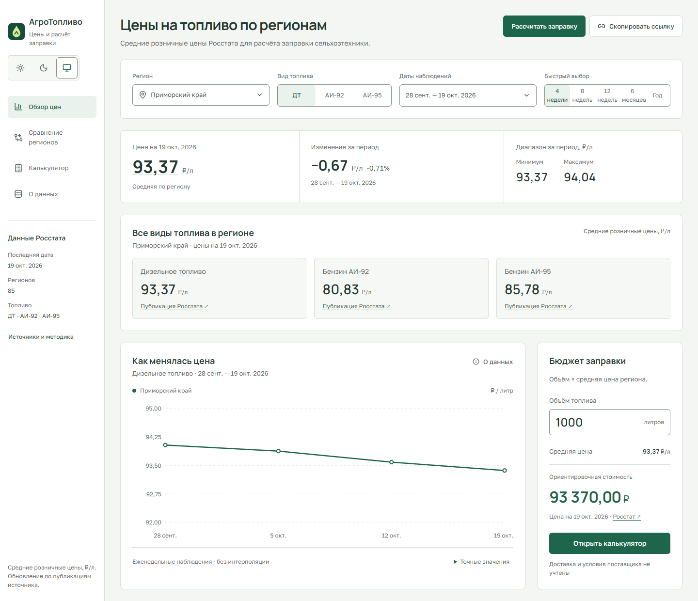
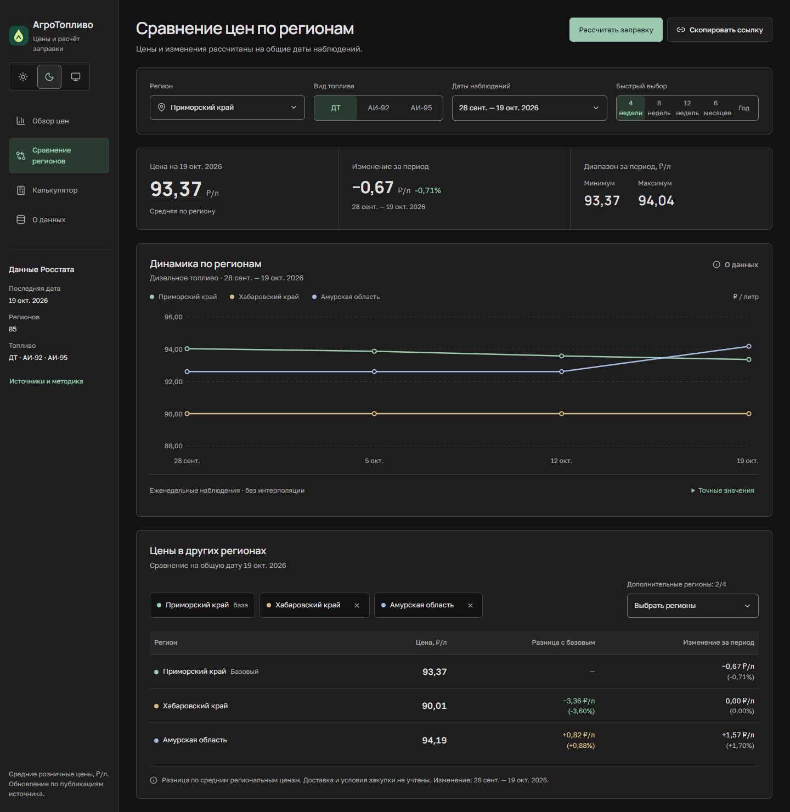
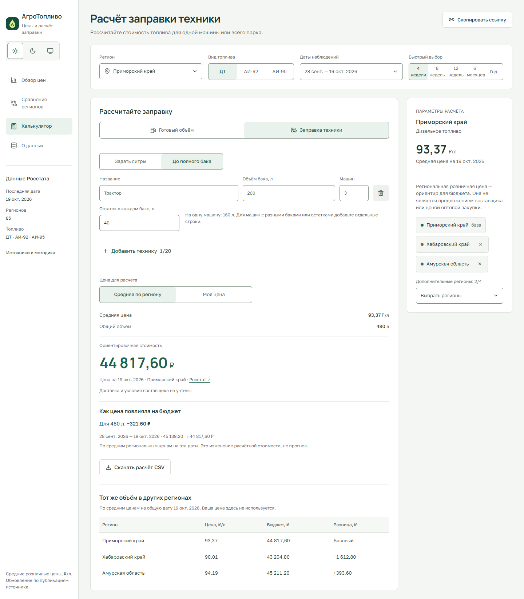

# АгроТопливо

Региональный сервис мониторинга цен на топливо и расчёта бюджета заправки сельхозтехники. Помогает оценить динамику цен, сравнить регионы и рассчитать стоимость нужного объёма топлива.

Проект разработан как решение кейса **«Мониторинг цен на топливо для сельхозтехники»** для участия в конкурсе на стипендию Россельхозбанка по [стипендиальной программе 2026–2027](https://rshbdigital.ru/stipendy/stipend-program2026-2027).

**[Открыть сервис](https://agro-fuel.duckdns.org/)** · [Метаданные API](https://fuel-prices.duckdns.org/api/v1/meta)

## Содержание

- [О проекте](#о-проекте)
- [Возможности и интерфейс](#возможности-и-интерфейс)
- [Источники данных](#источники-данных)
- [Технологии](#технологии)
- [Архитектура](#архитектура)
- [Структура репозитория](#структура-репозитория)
- [Быстрый запуск](#быстрый-запуск)
- [Конфигурация](#конфигурация)
- [API](#api)
- [Размещение и обновление данных](#размещение-и-обновление-данных)
- [Безопасность](#безопасность)
- [Автор, благодарности и лицензия](#автор-благодарности-и-лицензия)

## О проекте

АгроТопливо предназначено для фермеров, владельцев сельхозтехники и специалистов по снабжению. Пользователь выбирает регион, вид топлива и период, сравнивает цены и оценивает бюджет заправки одной машины или всего парка.

Результат конкурсного кейса — работающий веб-прототип: от открытых региональных данных до графиков, расчёта заправки и выгрузки бюджета. Учёт складских остатков, оформление закупок и прогнозирование цен в текущую версию не входят.

## Возможности и интерфейс

- Цены ДТ, АИ-92 и АИ-95 по 85 регионам из доступного набора Росстата.
- Графики и фильтры по региону, топливу и периоду, включая полугодие и год.
- Сравнение базового региона с четырьмя дополнительными на общие даты.
- Бюджет партии топлива или парка техники; долив до полного бака с учётом остатка.
- Собственная цена, оценка изменения бюджета в калькуляторе и экспорт расчёта в CSV.
- Светлая, тёмная и системная темы, мобильный интерфейс, резервный режим при недоступности API.

Обзор региональных цен, динамики и бюджета заправки:



<details>
<summary>Сравнение регионов и калькулятор заправки</summary>

**Сравнение регионов в тёмной теме**



**Расчёт долива до полного бака для парка техники**



</details>

## Источники данных

Источник — [еженедельные публикации Росстата](https://rosstat.gov.ru/compendium/document/50798) о средних потребительских ценах на бензин и дизельное топливо. Доступна история более года по 85 регионам для ДТ, АИ-92 и АИ-95.

Сервис сохраняет исходные документы, их SHA-256, даты наблюдений и версии наборов. Аномальные изменения проходят проверку перед публикацией. В интерфейсе доступны ссылки на документы и состояние обновления.

- Региональные средние используются как ориентир; доставка и условия конкретного поставщика в бюджет не входят.
- Пропуски сохраняются: цены между публикациями не интерполируются.
- Регионы сравниваются на общие даты. Выбранная версия данных закрепляется в запросах и ссылке.
- Архангельская и Тюменская области представлены без входящих автономных округов; эти территории учитываются отдельно.
- При недоступности API используется резервный снимок с явным указанием его даты и версии.

## Технологии

| Назначение                    | Технологии                                                                    |
| ----------------------------- | ----------------------------------------------------------------------------- |
| Приложение и серверный прокси | Next.js App Router, React, TypeScript                                         |
| Запросы и проверка ответов    | TanStack Query, Fetch API, Zod                                                |
| Графики и денежные расчёты    | Recharts, decimal.js                                                          |
| Оформление                    | CSS-переменные, Tailwind CSS, PostCSS; Lucide, локальные Golos Text и Manrope |
| API                           | Python, FastAPI, Uvicorn, Pydantic Settings                                   |
| Хранение и миграции           | SQLite/WAL, SQLAlchemy, Alembic                                               |
| Сбор публикаций               | httpx, BeautifulSoup, lxml                                                    |
| Размещение и обслуживание     | Vercel, VPS, systemd, nginx, Certbot, logrotate                               |

## Архитектура


Сборщик работает независимо от пользовательских запросов и сохраняет исходные публикации. API читает опубликованные версии; обновление набора не меняет данные ранее опубликованной версии. Браузер обращается к API через свой домен Next.js, а бюджет рассчитывается на клиенте с десятичной арифметикой.

## Структура репозитория

```text
fuel-prices/
├── frontend/
│   ├── src/app/          # Next.js, страницы и прокси API
│   ├── src/components/   # Фильтры, графики, сравнение, калькулятор
│   ├── src/lib/          # Контракты, работа с данными и расчёты
│   └── public/           # Резервный снимок и ресурсы интерфейса
├── backend/
│   ├── app/              # API, сборщик и операторские команды
│   └── migrations/       # Миграции SQLite
├── infra/                # Шаблоны конфигураций и службы systemd
├── shared/               # Общие примеры контрактов и расчётов
└── assets/screenshots/   # Скриншоты сервиса для README
```

## Быстрый запуск

Требования: Git и Node.js 22.12+. Для собственного API дополнительно нужен Python 3.12–3.14; сборщику требуется доступ к Росстату и не менее 2 ГБ свободного места согласно `.env.example`.

Запуск интерфейса:

```sh
git clone https://github.com/Owlmn/fuel-prices.git
cd fuel-prices/frontend
npm ci
npm run dev
```

Открыть [localhost:5173](http://127.0.0.1:5173). Без локального API приложение использует резервный снимок с указанной датой и версией. Настройка адреса API — в [frontend/README.md](frontend/README.md).

<details>
<summary>Запуск собственного API — Python 3.12–3.14, PowerShell</summary>

В отдельном терминале из корня репозитория:

```powershell
cd backend
python -m venv .venv
.venv\Scripts\python.exe -m pip install -r requirements.lock
Copy-Item .env.example .env
.venv\Scripts\python.exe -m app.cli init-db
.venv\Scripts\python.exe -m app.cli bootstrap --weeks 53
```

Проверить созданный набор и подставить его ID:

```powershell
.venv\Scripts\python.exe -m app.cli review VERSION_ID
.venv\Scripts\python.exe -m app.cli publish VERSION_ID --reason "Данные проверены" --operator YOUR_NAME
.venv\Scripts\python.exe -m uvicorn app.main:app --host 127.0.0.1 --port 8011
```

[Swagger UI](http://127.0.0.1:8011/docs) · [Описание API](backend/README.md)

Интерфейс в режиме разработки обращается к API на `127.0.0.1:8011`. Собственные адреса задаются через переменные окружения ниже.

</details>

## Конфигурация

Настройки фронтенда задаются в `frontend/.env.local`, бэкенда — в `backend/.env`. Примеры: [frontend/.env.example](frontend/.env.example) и [backend/.env.example](backend/.env.example).

| Переменная                   | Назначение и значение                                                                                                                                                     |
| ---------------------------- | ------------------------------------------------------------------------------------------------------------------------------------------------------------------------- |
| `FUEL_API_BASE_URL`          | Адрес API без `/api/v1`. По умолчанию в разработке — `http://127.0.0.1:8011`, в production — `https://fuel-prices.duckdns.org`. Пустое значение включает резервный режим. |
| `SITE_URL`                   | Публичный адрес фронтенда для превью ссылок. Пример: `https://agro-fuel.duckdns.org`. Без настройки используется адрес деплоя Vercel, локально — `http://127.0.0.1:5173`. |
| `FUEL_DATA_DIR`              | Каталог базы и оригиналов. В примере — `./data`, на VPS — `/var/lib/fuel-monitor`.                                                                                        |
| `FUEL_CORS_ORIGINS`          | Разрешённые адреса для прямого доступа браузера к API. По умолчанию — `["http://localhost:5173"]`.                                                                        |
| `FUEL_ROSSTAT_VERIFY_TLS`    | Проверка сертификата Росстата. По умолчанию в коде — `true`; в `.env.example` задано `false` для исключения на разрешённых адресах источника.                             |
| `FUEL_MIN_FREE_DISK_MB`      | Минимум свободного места для импорта: `2048` МБ.                                                                                                                          |
| `FUEL_ANOMALY_PERCENT`       | Порог недельного изменения цены для проверки: `10`%.                                                                                                                      |
| `FUEL_RATE_LIMIT_PER_MINUTE` | Лимит запросов API: `60` в минуту на IP.                                                                                                                                  |

Настройки окружения и локальная база исключены из Git. `FUEL_API_BASE_URL` используется серверной частью Next.js.

## API

| Метод и путь             | Назначение                                                                    |
| ------------------------ | ----------------------------------------------------------------------------- |
| `GET /api/v1/meta`       | Версия набора, регионы, виды топлива, даты, источники и состояние обновления. |
| `GET /api/v1/prices`     | История и сводные показатели для региона, топлива и периода.                  |
| `GET /api/v1/comparison` | Сравнение 2–5 регионов на общие даты; один регион задаётся базовым.           |

Сначала получите `dataset_version` из `/meta` и передавайте её в запросах цен и сравнения. Цены в JSON выражены в **копейках за литр**; виды топлива — `diesel`, `ai92`, `ai95`. Период задаётся параметрами `from` и `to` в формате `YYYY-MM-DD`, его длина ограничена 366 днями.

Пример получения последних четырёх дат наблюдений через PowerShell:

```powershell
$base = 'http://127.0.0.1:8011'
$meta = Invoke-RestMethod "$base/api/v1/meta"
$to = $meta.expected_dates[-1]
$from = $meta.expected_dates[[Math]::Max(0, $meta.expected_dates.Count - 4)]
Invoke-RestMethod "$base/api/v1/prices?region=primorsky_krai&fuel=diesel&from=$from&to=$to&dataset_version=$($meta.dataset_version)"
```

[Описание API](backend/README.md) · [Локальный Swagger UI](http://127.0.0.1:8011/docs)

## Размещение и обновление данных

**Фронтенд:** Vercel, Root Directory `frontend`, сборка `npm run build`. Подробные параметры — в [frontend/README.md](frontend/README.md#vercel).

**Бэкенд:** VPS, один процесс Uvicorn за nginx с HTTPS. API, сборщик и резервное копирование запускаются отдельными службами. Шаблоны — в [`infra/systemd/`](infra/systemd/).

Сборщик проверяет до 53 публикаций ежедневно в 07:00 UTC. Последние восемь перепроверяются при каждом запуске; ранее загруженная история сохраняется. Наборы с аномалиями ожидают проверки оператором через `review` и `publish`. Резервное копирование запланировано на 07:30 UTC; сохраняются семь последних ежедневных копий.

Резервный снимок фронтенда обновляется отдельно, после публикации проверенного набора:

```sh
# Из backend/
python -m app.cli export-snapshot exports/snapshot.json
# Затем из frontend/
node scripts/prepare-snapshot.mjs
npm run build
```

Снимок входит в сборку фронтенда; его версия и дата отображаются при переходе в резервный режим.

## Безопасность

- Публичный API предназначен для чтения. Импорт, проверка и публикация данных выполняются операторскими CLI-командами на сервере.
- В production браузер обращается к прокси Next.js по HTTPS. API на VPS слушает локальный адрес за nginx.
- Сборщик допускает только HTTPS-адреса `rosstat.gov.ru` и `www.rosstat.gov.ru`, включая проверку адресов перенаправлений.
- Исключение проверки сертификата в примере конфигурации относится только к запросам сборщика к Росстату. HTTPS-соединение фронтенда с API использует обычную проверку сертификата.
- Объём документов и время сбора ограничены; запросы API ограничиваются по частоте. Ответы проверяются по контракту, CSV экранирует формульные текстовые значения.

## Автор, благодарности и лицензия

Автор — [Owlmn](https://github.com/Owlmn).

Источник статистики — Росстат. Постановка кейса — [стипендиальная программа РСХБ 2026–2027](https://rshbdigital.ru/stipendy/stipend-program2026-2027).

Лицензия проекта пока не указана; файл `LICENSE` в репозитории отсутствует.
